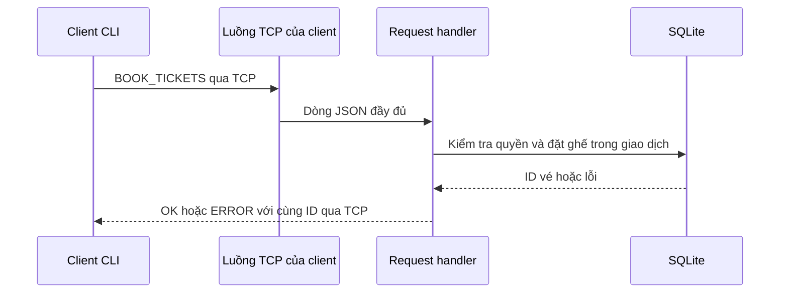

# Online Movie Ticket Booking System

Ứng dụng đặt vé xem phim của môn IT4062. Client dòng lệnh gửi yêu cầu qua TCP đến server C đa luồng. Server lưu tài khoản, phim, suất chiếu và vé trong SQLite.

## Cài đặt và chạy

Cần trình biên dịch C, Make, json-c, SQLite và OpenSSL. Trên macOS, Command Line Tools cung cấp SQLite. Nếu thiếu thư viện, chạy dòng phù hợp với máy.

```bash
# macOS với Homebrew
brew install json-c openssl@3 pkgconf

# Debian/Ubuntu
sudo apt install build-essential pkg-config libjson-c-dev libsqlite3-dev libssl-dev
```

Mở **terminal server** từ thư mục dự án và chạy.

```bash
make
./bin/server --init-admin admin
./bin/server
```

Lệnh `--init-admin` tạo tài khoản quản trị đầu tiên rồi thoát. Nhập mật khẩu khi được hỏi, ví dụ `Admin1234` cho dữ liệu demo. Từ lần chạy sau, chỉ cần `./bin/server`. Với script tự động, có thể truyền mật khẩu qua biến môi trường `TICKET_ADMIN_PASSWORD`. Khi server in `Ticket server listening on TCP port 3636`, để terminal này tiếp tục chạy.

Mở **terminal client** từ thư mục dự án.

```bash
./bin/client 127.0.0.1 3636
```

Khi thấy dấu nhắc `tickets>`, nhập các lệnh ở phần demo. Server mặc định dùng cổng `3636`. Nếu cổng đã có tiến trình khác dùng, có thể chạy server bằng `./bin/server 43636` và client bằng `./bin/client 127.0.0.1 43636`. Nếu mở thêm client, chạy cùng lệnh ở một terminal khác.

## Luồng demo

Nhập `help` trong client để xem toàn bộ lệnh. Trong terminal, các lệnh dưới đây hỏi mật khẩu và ẩn khi gõ. Đặt giá trị có khoảng trắng trong dấu ngoặc kép.

**Admin** đăng nhập bằng mật khẩu đã đặt và tạo tài khoản quản lý với mật khẩu demo `Manager1234`.

```text
login admin
create-user manager MANAGER
logout
```

`create-user USER ROLE` hỗ trợ `BUYER`, `MANAGER` và `ADMIN`. Dùng `set-role USER_ID ROLE` để đổi quyền. ID tài khoản xuất hiện khi tạo hoặc đăng nhập. Server kiểm tra quyền hiện tại cho mỗi yêu cầu.

**Sales Manager** đăng nhập bằng `Manager1234`, thêm phim, công bố suất ở nhiều phòng rồi đổi giờ một suất.

```text
login manager
theaters
add-movie "Đại Dương" "Phiêu lưu" 120 "Một chuyến đi biển."
add-showing 1 1 "2030-01-15 18:00" 3 "2030-01-15 19:00"
update-showing 2 starts_at="2030-01-15 19:30"
logout
```

Trên dữ liệu mới, server tạo phim #1, suất #1 ở Hà Nội và suất #2 ở Đà Nẵng. Sau khi sửa, suất #2 bắt đầu lúc 19:30. Dùng ID từ phản hồi nếu đã có dữ liệu. `theaters` liệt kê bốn phòng mẫu. `update-showing` nhận `theater_id=ID`, `starts_at="YYYY-MM-DD HH:MM"`, hoặc cả hai. Server từ chối lịch chồng giờ trong cùng phòng và khóa chỉnh sửa suất đã có vé đặt.

**Buyer** đặt mật khẩu demo `Buyer1234`, đăng nhập, tìm phim, lọc suất, xem sơ đồ và đặt hai ghế.

```text
register buyer
login buyer
search "đại dương"
browse genre="Phiêu lưu" location="Da Nang" date=2030-01-15 time=19:30
showings 1
seats 2
book 2 A1 A2
seats 2
exit
```

Các bộ lọc của `browse` có thể dùng riêng hoặc kết hợp. Sơ đồ hiển thị mã của ghế trống và `XX` cho ghế đã đặt. Một yêu cầu đặt được 1–10 ghế. Nếu một ghế đã có người đặt, giao dịch hủy toàn bộ lựa chọn và client có thể mở lại sơ đồ để chọn ghế khác. Nếu quản lý đổi phòng hoặc giờ sau khi mở sơ đồ, client sẽ yêu cầu mở lại sơ đồ trước khi đặt.

Đặt thành công sẽ thấy `Booking #1 confirmed.` trên dữ liệu demo mới. Sau đó `seats 2` hiện `XX` tại A1 và A2. Để quan sát hai chiều gửi nhận, mở một terminal khác từ thư mục đã chạy server.

```bash
tail -f data/server.log
```

Dùng `exit` để đóng client và Ctrl+C ở terminal server để dừng server. Khi chạy lại server trong cùng thư mục, tài khoản, phim, suất chiếu và vé vẫn còn trong `data/tickets.sqlite3`.

## Đọc code theo một lượt đặt ghế

Dùng lệnh `book 2 A1 A2` sau khi đã mở `seats 2`. Đây là đường đi của request và response.



Ví dụ dòng JSON do CLI gửi khi Buyer đã xem sơ đồ của suất #2. Ký tự LF kết thúc dòng sau dấu ngoặc nhọn cuối.

```json
{"id":16,"action":"BOOK_TICKETS","data":{"showing_id":2,"seats":["A1","A2"],"expected_showing":{"theater_id":3,"starts_at":"2030-01-15 19:30"}}}
```

1. **Kết nối client.** `main` kiểm tra IP và cổng, gọi `socket` và `connect`, rồi chuyển socket vào `client_main_loop`. Khi kết thúc phiên, `main` đóng socket. [Client main](src/client/main.c)
2. **Đổi lệnh thành request.** `commands[]` ánh xạ `book` sang `BOOK_TICKETS`. `split_words` đọc tham số và dấu ngoặc kép. `fill_data` tạo `data`, rồi `exchange` gắn ID request, gửi và chờ phản hồi. Nếu vừa xem sơ đồ, CLI gửi kèm phòng và giờ chiếu mà Buyer đã thấy. [Client CLI](src/client/ticket_cli.c)
3. **Gửi và nhận trên TCP.** `ticket_send_json` thêm LF. `send_all` lặp cho đến khi gửi hết byte. `ticket_read_line` giữ phần byte chưa dùng và đọc đến LF, vì một lần `recv` có thể trả nửa dòng hoặc nhiều dòng. [Giao thức](src/common/ticket_protocol.c) · [TCP gửi đủ dữ liệu](src/common/network.c)
4. **Tạo luồng và phiên.** Server gọi `bind`, `listen` rồi lặp `accept`. Mỗi socket nhận được có một `pthread`. `client_worker` giữ phiên và kết nối SQLite riêng, đọc từng dòng rồi gọi handler. `user_id = 0` là khách. Sau khi đăng nhập, mỗi request dùng `user_id` để tra quyền hiện tại trong SQLite. [Server main](src/server/main.c) · [Request handler](src/server/request_handler.c)
5. **Điều phối và thực hiện nghiệp vụ.** `ticket_handle_request` kiểm tra JSON, ID và quyền theo bảng `actions[]`. Với `BOOK_TICKETS`, handler gọi `ticket_book`. Server kiểm tra suất, phòng, giờ và các ghế, rồi ghi booking cùng tất cả ghế trong một giao dịch. [Request handler](src/server/request_handler.c) · [Đặt vé](src/server/ticket_booking.c)
6. **Trả kết quả và đối chiếu log.** `send_result` trả lại cùng ID request. CLI kiểm tra ID, trạng thái và cấu trúc phản hồi, rồi hiển thị mã đặt chỗ hoặc lỗi. Trong log, tìm `RECV` và `SEND` theo cùng `fd` và ID. Mutex trong `log_activity` bảo vệ các lần ghi log của nhiều luồng. [Client CLI](src/client/ticket_cli.c) · [Ghi log](src/common/utils.c)

### Các module nghiệp vụ và dữ liệu

| Module                                             | Khi nào đọc                                                                                                                                                                                 |
| -------------------------------------------------- | ---------------------------------------------------------------------------------------------------------------------------------------------------------------------------------------------- |
| [`ticket_auth.c`](src/server/ticket_auth.c)       | Muốn theo dõi `register`, `login`, `logout`, tạo tài khoản và đổi quyền. Mật khẩu được băm với salt riêng. Login gắn `user_id` vào phiên, logout đặt lại về 0. |
| [`ticket_catalog.c`](src/server/ticket_catalog.c) | Muốn theo dõi tìm phim, bộ lọc, danh sách phòng, thêm phim và xếp lịch. Lịch được kiểm tra theo thời lượng phim trước khi công bố hoặc cập nhật.                     |
| [`ticket_booking.c`](src/server/ticket_booking.c) | Muốn hiểu cách dựng sơ đồ ghế, từ chối ghế ngoài phòng hay đã đặt, và rollback cả lượt khi một ghế lỗi.                                                                |
| [`ticket_db.c`](src/server/ticket_db.c)           | Muốn xem bảng SQLite, dữ liệu phòng mẫu, hàm kiểm tra ngày giờ và cách commit hoặc rollback giao dịch.                                                                           |

Một dòng `showings` nối phim với phòng và giờ. Phòng thuộc một rạp. `bookings` nối Buyer với suất chiếu, còn `booked_seats` chứa từng ghế của booking. Khóa `(showing_id, seat)` bảo đảm A1 chỉ có một người đặt trong một suất. A1 của suất khác là một ghế có thể đặt riêng.

`include/client.h` khai báo điểm vào CLI. `include/network.h` khai báo hàm gửi đủ byte. `include/ticket_protocol.h` mô tả bộ đệm TCP và kích thước thông điệp. `include/common.h` chứa cổng và đường dẫn dữ liệu. `src/server/ticket_server.h` khai báo phiên, kết quả và các hàm nghiệp vụ. Makefile tập hợp các file để tạo hai chương trình `bin/client` và `bin/server`.

### Ba tình huống nên chạy khi đọc code

- **Một request đến từng mảnh.** Ca 02 chia một dòng JSON qua hai lần gửi, rồi kiểm tra client khác vẫn được phục vụ trong lúc chờ.
- **Hai Buyer tranh ghế.** Ca 33 gửi đồng thời hai lượt có một ghế chung. Một giao dịch thành công, lượt còn lại trả `SEAT_UNAVAILABLE` và các ghế trong lượt đó vẫn trống.
- **Mất phản hồi.** Ca 47 cho peer đóng kết nối giữa chừng hoặc gửi phản hồi sai cấu trúc. CLI báo lỗi và thoát với mã khác 0.

## Giao thức và lưu trữ

- Mỗi yêu cầu và phản hồi là một đối tượng JSON UTF-8 kết thúc bằng LF, tối đa 4096 byte tính cả LF. Server phản hồi với cùng `id` và trạng thái `OK` hoặc `ERROR`.
- `SEARCH_MOVIES`, `BROWSE_MOVIES`, `GET_SHOWINGS` và `LIST_THEATERS` hỗ trợ `after_id`. Dùng `next_after_id` trong phản hồi để lấy trang tiếp theo.
- `data/server.log` ghi `RECV` và `SEND`, với giá trị trường mật khẩu được che. SQLite lưu dữ liệu trong `data/tickets.sqlite3`. Mật khẩu được băm bằng PBKDF2-HMAC-SHA-256 với salt riêng.
- `GET_SEATS` trả thêm thông tin `showing` gồm phòng và giờ chiếu. CLI gửi lại thông tin đó qua `expected_showing` trong `BOOK_TICKETS`. Server trả `SHOWING_CHANGED` nếu phòng hoặc giờ đã đổi. Trường này là tùy chọn đối với client gửi request trực tiếp.
- Mỗi lượt đặt ghế chạy trong một giao dịch SQLite. Khóa duy nhất trên cặp suất chiếu và ghế ngăn hai lượt đặt cùng một ghế của cùng suất.
- Client xác nhận đặt vé bằng mã đặt chỗ. Giao thức TCP của đồ án truyền dữ liệu trực tiếp và phù hợp để demo trên localhost hoặc mạng lớp học.

## Kiểm thử

Chạy `make test` với Python 3 để build và kiểm thử client/server qua TCP localhost. Xem đầu vào, kết quả mong đợi và đối chiếu điểm rubric trong [bảng test case](tests/TEST_CASES.md).
