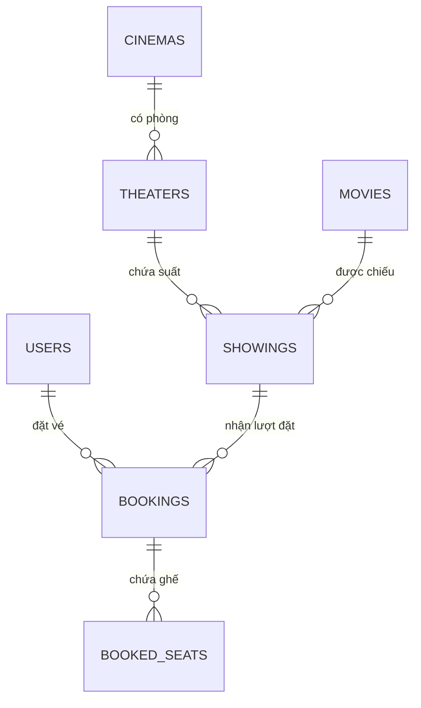

# Kiến trúc và cách đọc mã nguồn

Đồ án IT4062 có hai chương trình C. Client đọc lệnh trong terminal và gửi JSON qua TCP IPv4. Server giữ phiên riêng cho mỗi kết nối, điều phối yêu cầu theo vai trò và dùng chung một tệp SQLite để lưu dữ liệu. Có thể bắt đầu bằng [demo ba vai trò](../README.md#luồng-demo), rồi đọc theo thứ tự các hàm bên dưới.

## Bản đồ mã nguồn

| Mã nguồn | Điểm vào và trách nhiệm |
| --- | --- |
| [Makefile](../Makefile) | Build `bin/server` và `bin/client`. Hai chương trình dùng chung `network.c` và `ticket_protocol.c`. Server dùng thêm pthread, SQLite và OpenSSL libcrypto. |
| [src/client/main.c](../src/client/main.c) · [include/client.h](../include/client.h) | `main()` đọc IPv4 và cổng, gọi `connect()`, chuyển socket vào `client_main_loop()`, rồi đóng socket khi vòng lặp kết thúc. |
| [src/client/ticket_cli.c](../src/client/ticket_cli.c) | `commands[]` ánh xạ lệnh sang action. `split_words()` tách tham số, `fill_data()` tạo payload, `exchange()` gửi và đọc phản hồi, `show_success()` hiển thị dữ liệu. |
| [src/common/ticket_protocol.c](../src/common/ticket_protocol.c) · [include/ticket_protocol.h](../include/ticket_protocol.h) | `TicketStream` giữ các byte chưa đọc hết. `ticket_read_line()` tách thông điệp theo LF, `ticket_send_json()` thêm LF, `ticket_parse_json()` kiểm tra JSON và UTF-8. |
| [src/common/network.c](../src/common/network.c) · [include/network.h](../include/network.h) | `send_all()` gửi tiếp từ vị trí đã gửi nếu một lần `send()` chỉ ghi được một phần. |
| [src/server/main.c](../src/server/main.c) · [include/common.h](../include/common.h) | `main()` khởi tạo thư mục và schema. `serve()` lắng nghe và nhận kết nối. `client_worker()` phục vụ một socket cho đến khi đóng kết nối hoặc gặp lỗi I/O. |
| [src/server/request_handler.c](../src/server/request_handler.c) · [src/server/ticket_server.h](../src/server/ticket_server.h) | `ticket_handle_request()` đọc envelope, tra `actions[]`, kiểm tra quyền và gọi hàm nghiệp vụ. `TicketSession` chứa kết nối SQLite và `user_id`. `TicketResult` mang dữ liệu thành công hoặc mã lỗi và thông báo. |
| [src/server/ticket_auth.c](../src/server/ticket_auth.c) | Đăng ký, xác thực, chuyển trạng thái phiên, tạo tài khoản và đổi quyền. `ticket_bootstrap_admin()` phục vụ chế độ `--init-admin`. |
| [src/server/ticket_catalog.c](../src/server/ticket_catalog.c) | Tìm phim, lọc suất, phân trang, liệt kê phòng, thêm phim, thêm và sửa suất. `check_slot()` kiểm tra khoảng giờ chiếu trên cùng phòng. |
| [src/server/ticket_booking.c](../src/server/ticket_booking.c) | `ticket_get_seats()` đọc sơ đồ. `ticket_book()` xác thực lựa chọn, gọi `create_booking()` trong một giao dịch và trả mã đặt chỗ. |
| [src/server/ticket_db.c](../src/server/ticket_db.c) | Schema, phòng mẫu, kết nối SQLite, so khớp chữ hoa thường, kiểm tra chuỗi và ngày giờ, xử lý commit hoặc rollback. |
| [src/common/utils.c](../src/common/utils.c) | `log_activity()` giữ mutex trong lúc ghi log xuống tệp và in ra console. |
| [tests/ticket_booking_test.py](../tests/ticket_booking_test.py) | Test tích hợp qua TCP. Một nhóm test chạy binary CLI thật, các nhóm còn lại có thể gọi trực tiếp action JSON và đối chiếu SQLite. |

## Vòng đời kết nối và phiên

1. `main()` mở cơ sở dữ liệu, bật chế độ journal WAL và chạy schema. Chế độ `--init-admin` khởi tạo tài khoản Admin đầu tiên rồi thoát. Chế độ thông thường tiếp tục vào `serve()`.
2. `serve()` gọi `socket()`, `bind()`, `listen()` và `accept()`. Mỗi kết nối được nhận có một `pthread` tách rời. Bộ đếm `active_clients` dùng atomic và giới hạn hiện tại là 100 kết nối đang phục vụ.
3. Mỗi `client_worker()` tạo `TicketSession`, mở kết nối SQLite riêng và đọc từng dòng JSON theo thứ tự trên socket đó. Các worker khác có thể đọc và xử lý socket của mình cùng lúc.
4. Phiên mới có `user_id = 0`. `ticket_login()` tra username, băm lại mật khẩu bằng salt đã lưu và so với hash trong bảng `users`. Khi khớp, hàm ghi ID tài khoản vào phiên. `ticket_logout()` đặt lại về 0. Mở socket mới bắt đầu một phiên Guest mới.
5. Trước mỗi action của tài khoản đã đăng nhập, `authorize()` tra role theo `user_id` trong SQLite. Bảng `actions[]` quyết định vai trò nào được gọi hàm tương ứng. Xem [bảng action](PROTOCOL.md#bảng-action) để tra nhanh.

Trong `ticket_handle_request()`, trường `handle` là con trỏ tới hàm nghiệp vụ. Với `BOOK_TICKETS`, bảng `actions[]` gán nó cho `ticket_book()`. Handler chỉ gọi con trỏ hàm khi kiểm tra quyền trả về kết quả không có mã lỗi. [Nhánh điều phối](../src/server/request_handler.c#L159)

```c
result = authorize(session, action);
if (!result.code)
    result = action->handle(session, data);
```

Mật khẩu được lưu dưới dạng hash PBKDF2-HMAC-SHA-256 với 600.000 vòng, salt ngẫu nhiên 16 byte và hash 32 byte. `log_request()` che các trường có tên `password` khi ghi log. [Xác thực](../src/server/ticket_auth.c) · [Ghi log yêu cầu](../src/server/request_handler.c#L113)

## Từ lệnh đặt ghế đến SQLite

Ví dụ Buyer đang xem suất số 2. Khi chạy `seats 2`, `ticket_get_seats()` dùng một câu SELECT để lấy kích thước phòng, ghế đã đặt, ID phòng và giờ chiếu. CLI in `XX` cho ghế đã đặt và lưu cặp phòng, giờ theo `showing_id`. [Đọc sơ đồ](../src/server/ticket_booking.c#L11) · [Hiển thị và ghi nhớ sơ đồ](../src/client/ticket_cli.c#L251)

1. Với `book 2 A1 A2`, `put_seats()` tạo `showing_id` và mảng `seats`. `exchange()` lấy thông tin suất đã xem và đưa vào `expected_showing` nếu có. Client gửi action `BOOK_TICKETS` kèm một ID yêu cầu. [Tạo danh sách ghế](../src/client/ticket_cli.c#L175) · [Gửi yêu cầu](../src/client/ticket_cli.c#L363)
2. `ticket_handle_request()` kiểm tra envelope và quyền `BUYER`, sau đó gọi `ticket_book()`. Hàm này kiểm tra định dạng ghế và ghế lặp, rồi chạy `BEGIN IMMEDIATE` trước khi đọc trạng thái suất trong `create_booking()`. [Điều phối](../src/server/request_handler.c#L150) · [Bắt đầu giao dịch](../src/server/ticket_booking.c#L138)
3. `create_booking()` đọc phòng và giờ hiện tại, đối chiếu `expected_showing` khi được gửi, rồi kiểm tra mỗi ghế nằm trong phòng. Hàm ghi một dòng vào `bookings` và một dòng vào `booked_seats` cho từng ghế. [Kiểm tra và ghi ghế](../src/server/ticket_booking.c#L71)
4. `ticket_commit()` commit nếu mọi thao tác thành công. Nếu một ghế bị chiếm hoặc ghi SQLite thất bại, hàm rollback cả lượt. Sau khi hàm nghiệp vụ trả về, `send_result()` mới gửi `OK` kèm `booking_id` hoặc `ERROR` kèm mã lỗi. CLI đối chiếu ID rồi in kết quả. [Kết thúc giao dịch](../src/server/ticket_db.c#L140) · [Đóng gói phản hồi](../src/server/request_handler.c#L90)

## Mô hình dữ liệu



| Bảng | Quan hệ và ràng buộc |
| --- | --- |
| `users` | `username` duy nhất. `role` thuộc `BUYER`, `MANAGER`, `ADMIN`. |
| `movies` | Lưu tên, thể loại, mô tả và thời lượng từ 1 đến 500 phút. |
| `cinemas` và `theaters` | Một rạp có địa điểm và nhiều phòng. Phòng lưu số hàng và cột ghế. Schema tạo bốn phòng mẫu ở `Hanoi` và `Da Nang`. |
| `showings` | Một suất nối phim với phòng và giờ bắt đầu. `UNIQUE(theater_id, starts_at)` chặn hai suất cùng giờ bắt đầu trong một phòng. `check_slot()` còn chặn các khoảng giờ chồng lên nhau. |
| `bookings` | Một mã đặt chỗ thuộc một người dùng và một suất. `created_at` có mặc định `CURRENT_TIMESTAMP`. |
| `booked_seats` | Khóa chính `(showing_id, seat)` dành mỗi nhãn ghế cho tối đa một lượt đặt trên một suất. Khóa ngoại ghép `(booking_id, showing_id)` ràng buộc ghế và lượt đặt thuộc cùng suất. |

Schema nằm trong `ticket_db.c`. Mỗi kết nối bật `foreign_keys` và đặt SQLite `busy_timeout` là 5.000 ms. WAL cho phép đọc trong lúc một giao dịch khác đang ghi. Các giao dịch ghi được SQLite tuần tự hóa. [Schema và thiết lập kết nối](../src/server/ticket_db.c#L11)

## Cách lần theo các chức năng khác

- **Đăng ký và phân quyền.** Từ `REGISTER`, `CREATE_USER` và `SET_ROLE` trong `actions[]`, đọc `insert_user()` và câu UPDATE của `ticket_set_role()`. Câu UPDATE chỉ hạ quyền Admin khi còn một Admin khác. [Nghiệp vụ tài khoản](../src/server/ticket_auth.c)
- **Tìm phim và duyệt suất.** So sánh SQL của `ticket_search()` và `ticket_browse()`. Hàm đầu tìm chuỗi con trong tên phim. Hàm sau JOIN phim, suất, phòng và rạp rồi kết hợp các bộ lọc. Cả hai dùng `query_page()`. [Danh mục và phân trang](../src/server/ticket_catalog.c#L29)
- **Xếp lịch.** Đọc `ticket_add_showing()`, `ticket_update_showing()` và `check_slot()`. Kiểm tra và ghi cùng nằm trong giao dịch. Suất nối đúng giờ kết thúc của suất trước được chấp nhận. Suất đã có booking bị khóa sửa giờ và phòng. [Xếp lịch](../src/server/ticket_catalog.c#L240)

Các quy tắc giữ dữ liệu nhất quán, tình huống còn mở và cách đối chiếu bằng log và SQL nằm trong [tài liệu xử lý đồng thời và kiểm thử](RELIABILITY.md).
